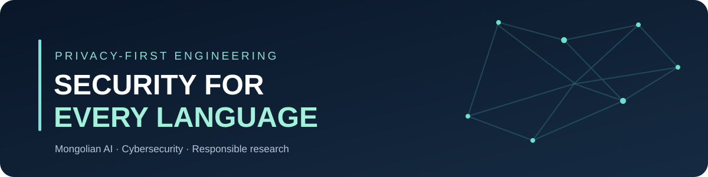

  

<h1 align="center">Building security tools for overlooked languages</h1>

  <strong>Cybersecurity · Responsible AI · Secure Software Engineering</strong> 
  Exploring practical, privacy-first tools for Mongolian-language users.

---
👋 About me
I'm an aspiring cybersecurity engineer from Mongolia. I'm interested in how people experience cybersecurity in languages and settings that mainstream security products may not prioritize.
My approach: define the problem → ship a reproducible prototype → test limitations → improve with evidence.
🔬 Featured work
Project	Problem I am exploring	Current status
KhelGuard	Explainable review of social-engineering signals in Mongolian and mixed-script messages	Local educational MVP; no real-world validation
DataLoom	Privacy-aware data field inventories for small teams	Offline prototype using synthetic schemas; publication pending
CivicProof	Source-evidence checks in low-connectivity situations	Research prototype using synthetic domains; publication pending
> These projects are early-stage research and engineering prototypes, not production security products. I do not claim real-world detection accuracy or external impact until independently measured.
🛠 Engineering toolbox
Currently studying and applying: Python · FastAPI · pytest · Git/GitHub · Basic NLP/ML evaluation · Secure software design · Privacy-by-design
Edit this section to match tools you personally understand and can explain. An initial scaffold is not proof of mastery.
📖 Learning & training
I have completed 50+ educational course certificates. I'm selecting six verifiable courses most relevant to my engineering work instead of displaying the entire collection.
Credential links will be added after I verify the exact course titles and public credential URLs.

🧪 Research and reproducibility
Current interests: mixed-script Mongolian text processing, interpretable security signals, privacy metadata classification, and human-centered security. Research proposals are not peer-reviewed publications.
🏢 Practical experience
Four-month internship at a technology company. Project details and contributions will appear here only after permission and accuracy review.
🧭 What I value
`Evidence over hype` · `Safety before automation` · `Real users, real constraints` · `Honest model limitations`
<!-- OWNER CHECKLIST BEFORE PUBLISHING:
Replace BilguuntugsBayarbat-svg; verify every statement; update projects as YOU test them;
remove unverified certifications; avoid disclosing private details or company information.
Starter scaffold prepared with AI assistance; independent author validation pending.
